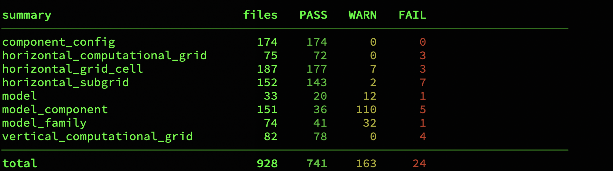
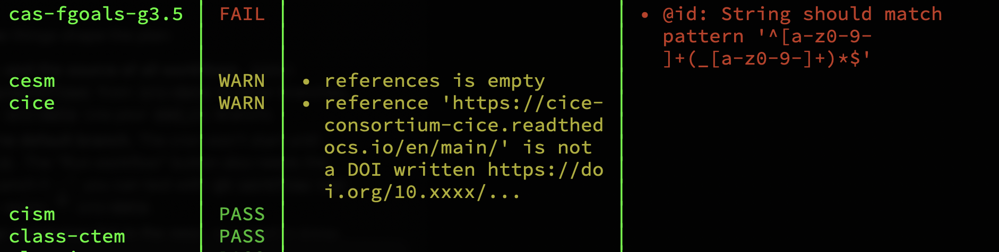

# Validating EMD Records

This page explains how to check every record in the repository against the EMD specification, on your own machine.
The checks are the same ones that run automatically in the repository's CI.

---

## What the validation does

The validation suite lives in `.github/EMD_tests` on the `src-data` branch.
It holds one [pydantic](https://docs.pydantic.dev/) model for each record folder (`model`, `model_component`, `horizontal_grid_cell`, …), and reads every `.json` file in those folders.

Each file gets one of three results:

| Result | Meaning |
|---|---|
| **PASS** | The record is valid and nothing needs looking at. |
| **WARN** | The record is valid, but something in it should be checked by a reviewer, such as a reference that is not a DOI. |
| **FAIL** | The record breaks a rule of the specification, such as a required property that is missing or a value that is not in its controlled vocabulary. |

---

## 1. Get the code

You need **Python 3.10 or newer** and **git**. Check your Python version with:

```bash
python3 --version
```

Clone the repository on the `src-data` branch, which holds the records and the suite:

```bash
git clone --branch src-data https://github.com/WCRP-CMIP/Essential-Model-Documentation.git
cd Essential-Model-Documentation
```

!!! tip "A faster download"
    If you only want to run the checks and not work with the history, add `--depth 1`:
    ```bash
    git clone --depth 1 --branch src-data https://github.com/WCRP-CMIP/Essential-Model-Documentation.git
    ```

If you already have a clone, update it instead:

```bash
git switch src-data
git pull
```

---

## 2. Install the dependencies

The suite needs only pydantic. Install it from the suite's requirements file:

```bash
python3 -m pip install -r .github/EMD_tests/requirements.txt
```

!!! note "Using a virtual environment"
    To keep the install separate from the rest of your Python packages, create a virtual environment first:
    ```bash
    python3 -m venv .venv
    source .venv/bin/activate          # on Windows: .venv\Scripts\activate
    python3 -m pip install -r .github/EMD_tests/requirements.txt
    ```

---

## 3. Run the report

From the root of the repository, run the suite folder:

```bash
python3 .github/EMD_tests
```

It prints one coloured table for each record folder and ends with a summary.
The command exits with code `1` when any file fails, so it can also be used in scripts.

### The summary

The last table counts the results for each folder. In this example, 928 files were read: 741 pass, 163 pass with warnings and 24 fail.



### Errors and warnings for each file

Above the summary, each folder has a table with one row per file: the file name, its result, its warnings (yellow) and its errors (red).
In this example, `cas-fgoals-g3.5` fails because a `.` is not allowed in an `@id`; `cesm` and `cice` load but have warnings about their references; `cism` and `class-ctem` pass.



### Show only the problems

To hide the files that pass, open `.github/EMD_tests/__main__.py` and set the flag near the top to `True`:

```python
ISSUES_ONLY = True   # True: list only the files that have an error or a warning
```

The summary still counts every file.

---

## Check a single record

To check one file, load it in Python from the root of the repository. The suite picks the right model from the folder name:

```python
import sys
sys.path.insert(0, ".github/EMD_tests")

from base import load

record = load("model_component/am4-2-aerosol.json")
```

An error raises a pydantic `ValidationError` that names the property and the problem. A warning is printed as an `EMDWarning`, and the record still loads.

---

## Where the checks are defined

Each record folder has a file of the same name in `.github/EMD_tests`, for example `model_family/` → `model_family.py`.
Each file defines one pydantic class, and every check is a short, named method with a one-line description and the section of the EMD specification it comes from.
Checks that every record shares, such as the format of `@id`, are in `base.py`.

---

## Automatic runs

The **EMD validation** workflow (`.github/workflows/emd-validate.yml`) runs the same report:

- on the 1st and 15th of each month, and on demand from its **Run workflow** button in the Actions tab;
- it updates the **EMD errors** badge on the repository's README with the number of failing files;
- when files fail, it opens or updates the issue *EMD validation failures* and tags the EMD reviewers, with a link to the full report.
